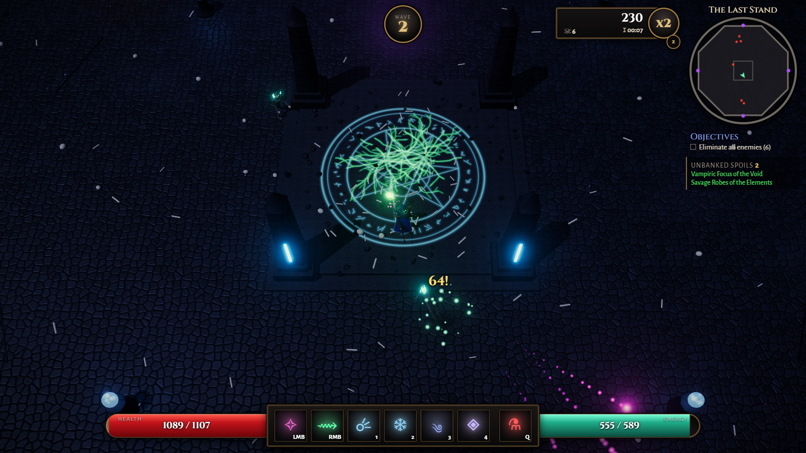
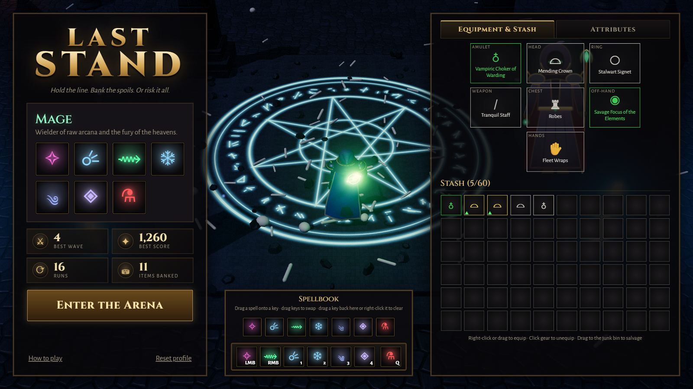
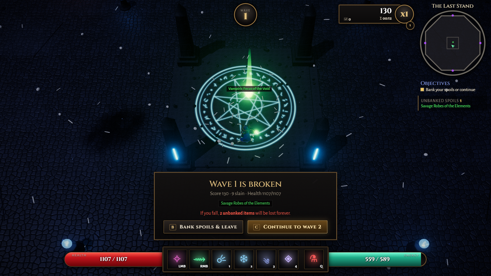

# Last Stand

[](https://github.com/VictorZakharov/last-stand/actions/workflows/deploy-pages.yml)

A 3D wave-survival action RPG that runs in your browser. Hold the arena against endless waves, and after **every** wave make the call: **bank your spoils** and walk away, or **push on** for better loot — knowing that if you fall, everything you haven't banked is lost.

**[▶ Play in your browser](https://last-stand.cc/)**

Everything is procedural: models, animation, textures, VFX and sound are generated at runtime. There are no downloaded models, textures or audio files. The exceptions are the painted skill icons (`src/ui/skillArt/`) and the music (`src/audio/music/`).



| Lobby: equipment, stash & spell loadout | Wave cleared: bank or continue? |
| --- | --- |
|  |  |

## How to play

- Pick a battleground in the lobby, the **Crypt** or the **Forest** (or the dice for a random one each run). Each has its own enemies.
- Start a run at any wave up to the best one you cleared **and banked** in that battleground (the lobby defaults to it); a run you died in doesn't count. On Random, the range is the waves banked in any battleground, and the dice roll among those the wave you pick is unlocked in.
- Survive each wave inside the arena. Every fifth wave, a boss arrives: the **Colossus** in the Crypt, the **Thornheart** in the Forest.
- After every wave, choose:
  - **Bank** — leave the arena and move everything you found into your stash, or
  - **Continue** — face a harder wave with better loot (you recover 25% health).
- Loot goes straight into your bag, **unseen**: you only know how many items of each rarity you carry (1 Legendary, 2 Epic...). Banking reveals what they are.
- Below half health the screen drains of colour and blood seeps in from its edges, more the closer you are to none.
- If you die, **all unbanked spoils are lost**, never seen.
- Equip what you find between runs; items roll random affixes across five rarities.

### Beta: the village lobby

A new lobby to try: a village you walk around, in place of the lobby's panels. Switch it on in the pause menu
(**Esc**), under **Beta**, and press **Reload**; the game remembers the choice, and a notice as it opens (or the same
tab) takes you back to the old lobby. Your heroes and saves are the same either way.

- Walk up to something and press **E** (or click it, or tap it) to use it: the portals to the **Crypt** and the
  **Forest**, the chest for your stash, the hall of heroes to change hero, the campfire to play together, the
  chronicle for save slots, the notice board for how to play, the ghost by the training yard for the training grounds.
- **I** opens the inventory (equipment, attributes, skills) anywhere and **M** the village's map. On touch, **Use**,
  **Bag** and **Map** stand beside the minimap, and a camera button changes the view.
- Skills work in the training yard, on its dummies: free while the inventory is open, with a run's costs and cooldowns
  once it's put away. A first visit starts with a short training round the village, which you can skip.
- In co-op a room is in its host's lobby: joining one in the other lobby offers to switch and join.
- **Duels:** in the village, a party can fight each other. The room's host sets a duel up at the weapons rack before the training yard (battleground, 1 v 1 or 2 v 2, first to 1, 3 or 5 rounds, own gear or none, who is on which side or watches), each fighter readies up there, and the host begins. No foes, no rewards, nothing lost or saved.

### Play together

Up to four players can hold the arena together over the internet, each under a name tag of their own (asked for once, and unique in a room). In the lobby, **Play together** → **Open a room** gives a short code and an invite link to send friends; opening the link (or entering the code) joins the room. The games talk through a small relay server of ours (`server/relay`, deployed by Dokci on every push to `main`), over a WebSocket that gets through any network a web page does.

- Each player brings their own hero, gear and loadout, and keeps their own spoils: loot goes to whoever lands the kill (a boss pays everyone), and each bag stays hidden until its owner banks.
- The host picks the battleground and starting wave and starts the run. A party faces more foes, each with more life.
- After every wave everyone chooses: **Bank** leaves the run with your spoils right away; the next wave starts once everyone staying chose **Continue**. Players who left watch the rest of the run: **left click** follows the next player, **right click** the one before, **Q** / **E** (or a middle drag) turn the camera, and **F** flies a free camera with `W A S D`; on touch the bar at the top has a button for each, and two fingers twisted turn the camera. Once nobody is left in the run, everyone goes back to the lobby together.
- At 0 health you go **down** rather than die. A teammate can raise you by standing next to you and holding **E** (the **Revive** button on touch) for 3 seconds. If you're not raised within 20 seconds, or you're still down when the wave ends, you fall and lose your spoils. With nobody left standing, the run is lost for everyone still in it.
- The game can't pause for one player: the pause menu only stops your hero. If the host leaves mid-run, the others keep what they found, as if banked.

### Install and play offline

Last Stand is an installable web app. Use the **Install** link in the lobby (Chrome, Edge, Android), or *Add to Home Screen* on iOS. Once it has loaded, it also plays without a connection. A new version downloads in the background, and the lobby offers a reload when it's ready.

### Controls

Plays with a keyboard and mouse, or by touch on phones and tablets (hold a phone sideways):
- **Move:** a stick anywhere on the left half of the screen.
- **Skills:** the buttons on the right. Tap to cast at the nearest foe, or drag to aim and let go to cast there; hold the attack button or a channelled skill to keep it going.
- **Other:** pinch to zoom, twist two fingers to turn the camera, and the ❚❚ button pauses.
- **Lobby:** tap items to equip them or drop them on the floor, and tap a key, then a skill, to rebind it.

Keyboard and mouse:

| Input | Action |
| --- | --- |
| `W A S D` | Move |
| Mouse | Aim |
| Left click, right click, `1`–`4`, `Q` | Skills (see the classes below) |
| Mouse wheel | Zoom |
| Middle mouse (hold and drag) | Rotate the camera |
| `V` | Change view (in a run or the lobby): top-down, over the shoulder, first person. The close views use mouse look and aim at the crosshair |
| `Alt` (hold) | In the close views: a cursor for the HUD (the battle log's buttons, the skills' tooltips), the view held still |
| `B` / `C` | Bank / Continue after a wave |
| `E` (hold) | Revive a downed partner (co-op) |
| `Left Shift` (hold, let go) | Ping the party (co-op): held, the mark follows the cursor onto the foe under it or the ground (over the minimap, its spot); let go, it's pinged there. On touch, a finger held on the minimap, lifted to ping |
| `Enter` | Chat with the party (co-op): type, `Enter` sends, `Esc` closes. On touch, the chat button under the scores |
| Left / right click, `Q` / `E`, `F` | Watching a co-op run: next / previous player, turn the camera, free camera |
| `Esc` | Pause |

Skills can be **remapped in the lobby**: the chevron beside the key bar (or a click on a key) opens the spellbook (the warrior's arsenal) above it. Click a key, then a skill, or drag a skill onto any key (the same skill may sit on several keys); drag keys onto each other to swap. The loadout is saved in a cookie per class and save slot. You can also walk around and try every skill for free in the lobby, and fold its panels away to make room: the hero panel to the left, the equipment to the right and the key bar down, each by the tab on its edge (the lobby remembers).

## Classes

Pick a class in the lobby. Every class keeps its **own profile**: equipment, stash, records and the starting waves unlocked in each biome. Loot found by one class is made for it and stays with it, and each class has its own stash filter.

There are **three save slots** (the lobby's *Save slot* link), each a separate save with its own heroes, skill loadouts and stash filters. The save slots screen shows what each one holds: every hero's best wave and starting waves per battleground, gear with its item levels, skills, attributes, stash, records and time played. From there you play a slot or delete one (typing DELETE to confirm). An empty slot is a fresh start, for instance to play from the beginning with a friend. Progress from before save slots is in slot 1.

**Cloud saves** (optional): sign in on the save slots screen with a passkey, with Google, or with a sign-in code from a device already signed in, choose which save goes to the cloud, and slot 1 keeps the same heroes on every device you sign in on. It keeps playing offline and syncs when back online; a hero played on two devices while out of sync asks which copy to keep. No account is needed to play. What is kept, and how to delete it: [privacy](public/privacy.html).


### The Mage

Robes, skirt panels and a crystal staff; arcane and elemental spells from range. A staff is attuned to a school (arcane, fire, lightning or healing), shown by its crystal's colour, and the school sets the spell on left click. With no staff, Void Lance is cast from either hand, or from both with two of its keys held, harder and at a higher cost in Energy.

| Key | Spell |
| --- | --- |
| Left click | By the staff's school: Splintering Bolt (arcane) — seeking bolts that split on impact; Cinderburst (fire) — a slow orb that bursts and may set foes alight; Stormcall (lightning, hold) — charge up to 3 s, release to strike and daze; Lifethread (healing, hold) — an arching beam that heals the ally you aim at, or you |
| Right click | Starfall — crystal meteors crash onto the target area |
| `1` (hold) | Void Lance — channeled piercing beam |
| `2` | Glacial Nova — freeze everything around you |
| `3` | Maelstrom — roaming vortex that pulls enemies in and shocks them |
| `4` (hold) | Veilstep — hold to choose a spot up to 15 m away, let go to cross there as a streak of arcane light, through anything in the way; foes close by as you vanish are dazed for a second |
| `Q` | Healing Draught |

### The Warrior

Plate armour and a crested helm; tougher, and fights up close. Fights with a one-handed weapon and a shield, a one-handed weapon in each hand (the swings alternate hands; the off-hand weapon adds 60% of its damage bonus), or a two-handed weapon, and the model shows what is equipped. Each of these styles remembers its own skill bindings, with a button in the lobby to reset them to the defaults.

Shields **block**: each hit has the shield's Block Chance to be blocked, absorbing its Block Amount, after which the shield needs a moment to recover. Holding right click raises the shield to block every hit from the front, for three times the Block Amount; a hit bigger than that breaks the guard and staggers you: for 1.5 seconds you can only move, not block, attack or cast. While holding Raise Shield, attack to lower the guard for the swing; it rises again as soon as the attack ends if block is still held. On touch, hold the shield button with one finger and attack with another.

| Key | Skill |
| --- | --- |
| Left click | Rending Cleave — wide sweep in front of you; each hit restores energy |
| Right click (hold) | Raise Shield — block every frontal blow; with a two-handed weapon instead: Steel Tempest; with a weapon in each hand: Twin Fangs, an instant lunge and a strike with each blade (a lone one-hander leaves it free to bind; Thunder Crescent needs a two-hander) |
| `1` (hold) | Steel Tempest — spin with the blade out, shredding everything around you |
| `2` | Bull Rush — shield charge that tramples and hurls foes aside |
| `3` | Power Strike — charge for 1.5 seconds, then a crushing overhead blow |
| `4` | Iron Bellow — war cry that hurls foes back and grants a damage-absorbing ward |
| `Q` | Healing Draught |

### Ranger

A bow hunter in a green trailcoat with a quiver, leather bracers and boots. The Ranger trades heavy armour for speed and ranged physical damage. Bows occupy both hands, and Ranger loot omits off-hands and unused arcane, elemental and block bonuses. Each class keeps its own equipment, stash, records and skill bindings.

| Key | Skill |
| --- | --- |
| Left click | Nockshot — hold to draw, release to loose: the further it is drawn, the faster and harder the arrow; a tap looses a quicker, lighter shot, and taps during a reload queue the next one |
| Right click | Briarflight — hold to draw five arrows across the bow laid flat, release to loose them in a broad fan |
| `1` | Lancewood Shot — hold to draw, release to drive the arrow through every foe in its line, each one after the first taking less (100/80/60/40%); drawn to full it strikes half again as hard |
| `2` | Hailfletch — hold to stand and shoot arrow after arrow over the target area, each splitting into a shower of 24 that lands at random across it, each arrow striking the foe it falls on, until you let go; the area follows your aim at a walk |
| `3` | Quarry Mark — the foe nearest your aim takes 25% more damage from everyone; when it dies your cooldowns are refreshed |
| `4` | Strawman — a scarecrow that draws every nearby foe but elites and bosses off you for 3 seconds, gathering them round it |
| `Q` | Healing Draught |

## Tech

- [Three.js](https://threejs.org/) 0.187 with an HDR post-processing chain (bloom, tone mapping, grading)
- The Thornwood's trees are grown by [ez-tree](https://github.com/dgreenheck/ez-tree) (MIT), its geometry with our own procedural bark and leaves
- The fires' flames are a fluid simulated once and played back, after the physics of [Fire Pro](https://github.com/dgreenheck/threejs-fire-pro) (MIT)
- TypeScript (strict) + [Vite](https://vite.dev/)
- Procedural textures (cobblestone, slabs, runes), procedural humanoid rigs and animation, CPU particles, pooled dynamic lights
- WebAudio-synthesized sound effects, and music for each biome: one track in its lobby and between waves, one through each wave's fight (looped by `tools/music`)
- Co-op through our own WebSocket relay server (`server/relay`, Node and [ws](https://github.com/websockets/ws))


## Development

```bash
npm install
npm run dev        # http://localhost:5173
npm run typecheck
npm run build      # type-check + production build into dist/
```

### Project layout

| Path | Contents |
| --- | --- |
| `src/data/` | Tuning data: classes & skills, enemies, biomes, items, waves, balance |
| `src/combat/skills/` | Skill behaviors, referenced by name from class data |
| `src/entities/` | Player, enemies, enemy AI, procedural models (`models/`) |
| `src/game/run.ts` | Wave flow, scoring, loot rolls, bank / continue |
| `src/world/` | The biome arenas (`crypt.ts`, `forest.ts`), shared props, collision |
| `src/fx/` | Particles, effects, pooled lights |
| `src/loot/` | Items, persistent profiles (one per class and save slot: stash / equipment / records), save slots, skill loadout |
| `src/net/` | Co-op: rooms and links between the games, the players' state, the host's reports of the fight |
| `src/ui/` | HUD, menus, tooltips, loadout editor, skill icons |

**Adding a class:** create a data file in `src/data/classes/`, register it in `src/data/classes/index.ts`, add a model in `src/entities/models/`, and implement any new skills in `src/combat/skills/`.

## Feedback

This is an early build — feedback, bug reports and ideas are very welcome in [Issues](https://github.com/VictorZakharov/last-stand/issues). To contribute code, see [CONTRIBUTE.md](CONTRIBUTE.md).

## License

[MIT](LICENSE).

### Training grounds

Choose **Training grounds** in the lobby, pick a battleground and any wave that hero has reached there (including waves lost). Fight holographic enemies with normal skill costs and cooldowns, but take no damage and earn no loot, score or progression. After clearing a wave, repeat it or leave. In co-op the host chooses the mode, biome and wave for everyone. Older saves initially offer their banked waves because earlier failed attempts were not stored by biome.

### Optional party portraits

In **Play together**, open **Your portrait (optional)** to choose from five male portraits in one row for your current class, or **None**. Each set uses Blue, Red, Green, Purple and Ochre outfits. Each class remembers its own choice across save slots. Portraits appear in the lobby and fight party lists only. Unchosen pictures are not downloaded until the picker opens; other classes’ sets stay unloaded.

The top-left co-op party list shows your card first, marked by a gold line on its left edge, followed by your partners. Cards show the player name, class in its Hero Selection colour, portrait, health and current status. A gold star at the bottom-left of a portrait marks the host.
